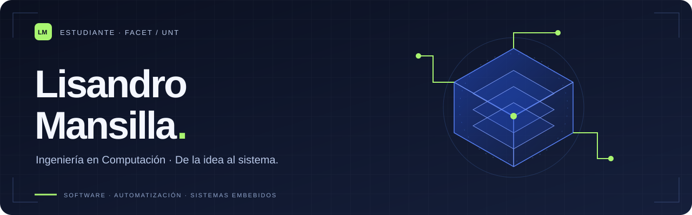

# Hola, soy Lisandro.

Estudio **Ingeniería en Computación en FACET, Universidad Nacional de Tucumán**. Me interesa conectar software, electrónica y redes para resolver problemas concretos.

Trabajo en proyectos de automatización, desarrollo web y sistemas embebidos. Me gusta entender el sistema completo: los requisitos, el código, la infraestructura y lo que hace falta comprobar para que funcione.

### Proyectos destacados

| Proyecto | Qué estoy construyendo | Estado |
|---|---|---|
| [**Consultorio digital**](https://github.com/LisandroMansilla/consultorio-automatizacion) | Integración de Docker, n8n, MySQL y WAHA para recordatorios y confirmaciones de turnos. Caso técnico, documentación y herramientas de medición. | Sistema desplegado; métricas e indicadores con alcance documentado. |
| **Indoor IoT / ESP32** | Supervisión ambiental de dos carpas independientes, control local y medición modular del sustrato con SHT31/SHT30 y ADS1115. | Prototipo v1.1 en desarrollo. Validación física y backend operativo pendientes; código en preparación para publicación. |

### Herramientas y conocimientos

| Área | Conocimientos que aplico |
|---|---|
| Software y modelado | Desarrollo web, UML, análisis de requerimientos y Enterprise Architect. |
| Automatización e infraestructura | Docker / Compose, n8n, MySQL, integración de servicios y diagnóstico en VPS. |
| Hardware y sistemas | ESP32, sensores I²C, C++, arquitectura de computadoras y fundamentos de redes. |
| Datos y gestión | Excel, organización de información y documentación técnica. |

### Otros trabajos

- **AdoptaMe:** proyecto académico de análisis de requerimientos y modelado UML.
- **Electrónica I:** control analógico de temperatura en lazo cerrado, realizado en equipo.
- **Rifa Admin y ruleta:** gestión de rifas y presentación visual del resultado del sorteo.
- **GymMemory:** aplicación web en evolución para rutinas e historial de entrenamiento.

### Cómo presento mis proyectos

**Problema → decisiones → implementación → evidencia.** Documento lo que funciona y dejo visibles las validaciones pendientes. Las pruebas de software y los resultados de operación tienen contextos diferentes.

[Explorar el caso del Consultorio ↗](https://github.com/LisandroMansilla/consultorio-automatizacion)

---
Software, automatización y sistemas embebidos. Proyectos propios y académicos, en evolución.
